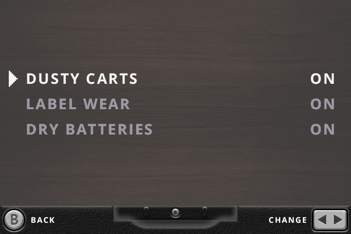
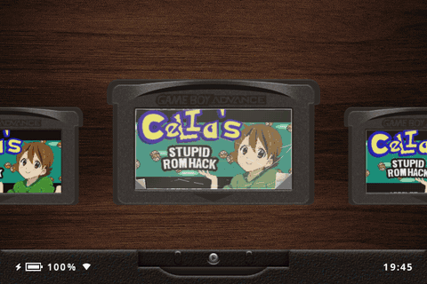
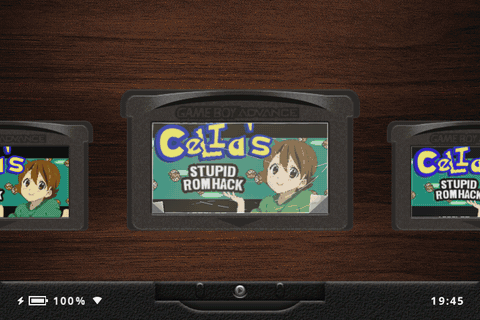
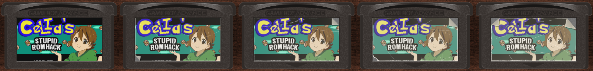
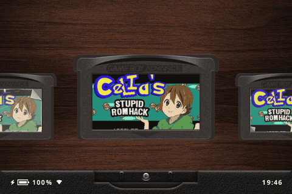

---

# What is slot?

A bespoke, Game Boy-centric frontend for the Anbernic RG SP.

Has support for GBA, GBC, and GB titles only.

> [!IMPORTANT]
> ROMs must be unzipped. slot does not read `.zip` or `.7z` files.

A full user guide can be found at [slot-cfw.fyi](https://slot-cfw.fyi).

---

# What does it look like?

---

# Added in this fork

This fork, **slot-blow**, adds three features that make your carts behave like real, decades-old cartridges.
They all live under **Quick Menu > Gameplay > Experimental**, and you can turn each one on or off there.

## Dusty Carts: blow on the cart

One cart in ten fails to boot. Instead of the game, the screen shows scrambled tiles and the emulator stays paused.
Hold or mash **B** to blow on the cart. When the breath meter fills, the cart pops back out to the shelf,
slides back in, and gets a new roll of the dice.

- The glitch looks different on each platform: a garbled logo on GB, garish tiles on GBC, stripes on GBA.
- It tears harder the more you blow.
- A cart resumed at boot never comes up dusty.

## Dry Batteries: solder in a new cell

One cart in ten that boots clean shows the notice from the Pokémon games instead:
*"The internal battery has run dry. The game can be played."* Reading on does not start the game. It opens
the cart on a soldering bench:

1. **Desolder** the old cell: hold **A** on each tab until the solder melts.
2. **Solder** the new cell: hold **A** to heat the iron and let go while the gauge is in the green.
   Let go too early and you get a dull cold joint. Hold too long and the pad burns, and you have to wait for it to cool.
3. Once both joints shine, the notice comes back to say clock-based events will occur again, and the game starts.

The bench is drawn in the game's own style, with a Gen 3 text box on GBA, a Gen 2 text box on GB/GBC and four greys on GB.
Dusty Carts rolls first, so a cart you just blew on can still have a dry battery.

## Label Wear: carts age as you play

Play time is tracked per cart (in `Config/play_time.txt`), and the label wears down as the hours add up.
It fades and yellows, then gathers scratches, a thumb smudge and frayed edges, and finally two or three
dog-eared or torn corners. Each cart keeps its own damage in the same places. Wear goes up in steps from
1 hour to 100 hours of play.

 
The same label after 0 h, 5 h, 20 h, 50 h and 100 h of play.

## Testing

To skip the dice roll, set these environment variables:

| Variable    | Values             | Effect                                           |
|-------------|--------------------|--------------------------------------------------|
| `SLOT_DUST` | `always` \| `off`  | Every cart comes up dusty, or none does          |
| `SLOT_DRY`  | `always` \| `off`  | Every clean boot has a dry battery, or none does |

---

# Supported Devices

| Device                | Supported | Since Version |
|-----------------------|-----------|---------------|
| Anbernic RG SP        | **Yes**   | Always        |
| Anbernic RG 34XX      | **Yes**   | 1.4.0         |
| Anbernic RG 34XXSP    | **Yes**   | 1.4.0         |
| Anbernic RG 35XXSP    | **Yes**   | 1.5.0         |
| Anbernic RG 35XX Plus | **Yes**   | 1.5.0         |
| Anbernic RG 35XX-H    | **Yes**   | 1.7.0         |
| Anbernic RG 35XX Pro  | **Yes**   | 1.15.0        |
| Anbernic RG 28XX      | **Yes**   | 1.6.0         |

If you have one of the untested devices, or have tried slot on a device not listed,
please [open an issue on GitHub](https://github.com/slot-cfw/slot/issues) and let me know how it went.

---

# Discord Community

slot has a [Discord server](https://discord.gg/NYRWsSuPUu) for questions, sharing setups, and talking about the project.

It is open to everyone in the slot universe. That includes folks running or building forks of slot.

There is no reason for this community to be fragmented so long as we are having fun!

---

# AI Disclosure

The Rust frontend, and the SVGs on [slot-cfw.fyi](https://slot-cfw.fyi), were put together by Claude.
I reviewed everything that was produced. All documentation is 100% free-range, meatbag prose.

My goal with this project was to recreate the feeling of playing my GBA SP in the back seat as a kid,
but with a few modern creature comforts.

Nothing about this project is exciting or groundbreaking from a technological perspective, and as a
result, I delegated the glue code. mGBA, gpSP and Gambatte have been around forever and are the true stars of
this show. The incredible skeuomorphic art is the work of [Markus](https://github.com/MarkusMaribu), an
artist who saw the bare-bones version and offered to dress it up.

I understand if my use of AI is a dealbreaker for you. Just know it's the least interesting part of
what's here.

Figured I should share the end result of all the wasted water. ✌🏻

---

# Spread Joy!

I've spent a lot of time building slot.

If you enjoy using it and feel inclined to pay it forward, go do something nice for someone! ❤️
